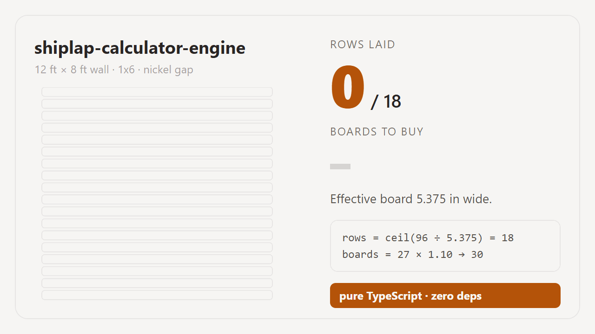

# shiplap-calculator-engine

**The calculation engine behind [wallboardcalc.com](https://wallboardcalc.com)** — shiplap board counts and drywall material takeoffs, in pure TypeScript.

**[→ Use the full calculator (free, no signup)](https://wallboardcalc.com/shiplap-calculator/)**

[](https://wallboardcalc.com/shiplap-calculator/)

- Zero dependencies. No React, no DOM, no network — just functions that take numbers and return numbers.
- Synchronous and pure, so a UI can recompute on every keystroke.
- Every formula below is the one in the source. No hidden fudge factors.
- MIT licensed. Use it in your own tool, fork it, ship it.

```bash
# install straight from this repo (built on the fly via the prepare script)
npm i github:cxl769807768/shiplap-calculator-engine

# an npm release is planned — this will work once it lands:
npm i shiplap-calculator-engine
```

```ts
import { calculateShiplap, purchasePlan } from 'shiplap-calculator-engine';

const r = calculateShiplap({
  wallLengthIn: 144,   // 12 ft
  wallHeightIn: 96,    // 8 ft
  boardWidthIn: 5.5,   // 1x6, dressed
  revealIn: 0.125,     // nickel gap
  boardLengthIn: 96,   // 8 ft stock
  wasteRatio: 0.1,     // 10%
  openingsSqIn: 0,
});

r.rows;        // 18
r.boards;      // 30  (27 needed + 10% waste)
r.linearFeet;  // 216

purchasePlan(r.boards, 3); // { packs: 10, boards: 30, spare: 0, packSize: 3 }
```

---

## Why this exists

Most shiplap calculators divide wall area by board area and round up. That answer is wrong in two directions at once: it ignores that boards come in fixed lengths you have to cut, and it quietly uses the nominal board width from the shelf tag instead of the width the board actually covers.

This engine does the arithmetic the way a carpenter does it:

1. Use the **dressed** board width, then subtract the reveal.
2. Count **rows**, not area.
3. Work out how many boards each row eats, and reuse the offcut from one row on the next.
4. Only then apply the waste allowance.

The live site shows the same three steps to the visitor before showing any number — that is a deliberate product decision, not a marketing line. If a calculator will not show its formula, you cannot tell a wrong answer from a right one.

## The shiplap engine

```ts
calculateShiplap(input: ShiplapInput): ShiplapResult
```

All dimensions in **inches**. Inches are the canonical unit; conversion happens only at the input/output edge (see `units.ts`).

| Field | Meaning |
| --- | --- |
| `effectiveWidthIn` | `boardWidthIn − revealIn` — what one board actually covers |
| `rows` | `ceil(wallHeightIn ÷ effectiveWidthIn)` — horizontal courses |
| `finalRowWidthIn` | Height left over for the top course |
| `finalRowNeedsCut` | True when the top course needs a rip cut |
| `suggestSplitRows` | True when the top rip is under 1¼ in — split it top and bottom instead |
| `finishedRowLengthIn` | Row length after openings are deducted proportionally |
| `linearFeet` | `rows × finishedRowLengthIn ÷ 12` |
| `boardsNeeded` | Cut-aware count **before** waste |
| `boards` | `ceil(boardsNeeded × (1 + wasteRatio))` — what to buy |
| `openingsSqIn` | Opening area actually deducted (clamped at 90% of the wall) |
| `openingsOverflow` | True when the entered openings exceeded that clamp |

### Worked example — 12 ft × 8 ft wall, 1x6, nickel gap

```
effective width = 5.5 − 0.125              = 5.375 in
rows            = ceil(96 ÷ 5.375)         = 18
final row       = 96 − 17 × 5.375          = 4.625 in   → needs a rip cut

per row: 144 in ÷ 96 in = 1 full board, remainder 48 in
a 96 in board yields two 48 in pieces, so 18 rows need
   18 full boards + ceil(18 ÷ 2) offcut boards = 27
boards to buy   = ceil(27 × 1.10)          = 30
```

That 27 → 30 gap is the whole point of doing it this way. A pure area calculation says `13824 ÷ (5.375 × 96) = 26.8 → 27` and sends you home two boards short once you have wasted the ends.

### The dressed-width trap

| Nominal | Dressed face | Rows on an 8 ft wall (dressed) | Rows if you use the nominal | Rows you'd miss |
| --- | --- | --- | --- | --- |
| 1x4 | 3½ in | 28 | 24 | 4 |
| 1x6 | 5½ in | 18 | 16 | 2 |
| 1x8 | 7¼ in | 14 | 12 | 2 |

A nominal 1x6 is 9% wider than the 5½ in you actually get; on an 8 ft wall that is two courses you never counted, and two courses is two rows of boards. That is the single most common way a shiplap estimate goes wrong, so `presets.ts` ships the dressed widths and never the nominal ones.

### Cost and purchasing

```ts
purchasePlan(boards, packSize) // → { packs, boards, spare, packSize }
calculateCost({ boards, boardPrice, nailBoxes, nailPrice, adhesiveTubes, adhesivePrice })
```

Retailers sell fixed pack sizes, so the honest number to budget with is `packs × packSize`, not the bare board count. `purchasePlan` is what keeps the estimate and the receipt from disagreeing.

## The drywall engine

```ts
calculateDrywall(input: DrywallInput): DrywallResult
```

Dimensions in **feet**, fastener spacing in inches. Inputs: room length/width/height, optional ceiling, door and window counts, large openings, sheet size, thickness, waste, outside corners. Or skip the room maths with `useArea: true` and a known square footage.

**Coefficients are published figures, not guesses:**

| Coefficient | Value | Source |
| --- | --- | --- |
| Joint compound | 10 gal per 1,000 sq ft | USG Sheetrock All Purpose, submittal J1969 |
| Paper tape | 370 ft per 1,000 sq ft | USG Sheetrock Paper Joint Tape, submittal J1736 |
| Screws, walls | 28 per 4 × 8 sheet (16 in o.c.) | USG fastener spacing |
| Screws, ceilings | 35 per 4 × 8 sheet (12 in o.c.) | USG fastener spacing |
| Sheet weight | 1.78 lb/sq ft (½ in), 2.19 (⅝ in) | manufacturer data |

Worked example — 12 × 14 ft room, 8 ft walls, 1 door, 2 windows, ½ in, 4 × 8 sheets, 10% waste:

```
walls   = 2 × (12 + 14) × 8   = 416 sq ft
ceiling = 12 × 14             = 168 sq ft
openings = 21 + 2 × 15        = 51 sq ft
net      = 416 − 51 + 168     = 533 sq ft
sheets   = ceil(533 ÷ 32 × 1.10) = 19
screws   = 365 × 28/32 + 168 × 35/32 = 504
tape     = ceil(0.533 × 370)  = 198 ft
compound = 0.533 × 10         = 5.3 gal → 2 pails (4.5 gal each)
```

Fasteners and finishing are quoted against the boarded area **before** waste — you do not screw or tape the sheets you never hung.

`heightAdvice` reports how the wall height lands against the 4 ft sheet width: `exact` (no rip), `strip` (a rip between 1 and 4 ft), `narrow` (a rip under 1 ft, where the waste allowance stops being generous).

## Units and presets

```ts
import {
  US_BOARD_STYLES, UK_BOARD_STYLES,   // dressed widths: 1x6 = 5.5 in, 150 mm = 144 mm face
  US_BOARD_LENGTHS, UK_BOARD_LENGTHS, // 8/12/16 ft, 2.4/3.0/3.6 m
  REVEAL_OPTIONS, WASTE_OPTIONS,
  formatLength, formatArea, formatMoney, splitImperial, splitMetric,
} from 'shiplap-calculator-engine';
```

`units.ts` keeps inches as the single source of truth so the imperial and metric UIs cannot drift apart. Formatting uses `Intl.NumberFormat`, so currency output follows the visitor's locale rules rather than hard-coded symbols.

## What this engine deliberately does not do

- **No cut list.** It counts boards; it does not lay them out. Real walls have outlets, corners and unplumb studs, and pretending a 20-line function knows where your window sits would be worse than saying so.
- **No structural or code advice.** Nothing here covers fire rating, substrate, moisture barriers or code compliance. Ask a local pro.
- **No opening positions.** Window and door area is deducted proportionally across every row, which keeps the board count honest without inventing a layout.

## Development

```bash
npm install
npm test        # builds, then runs the test suite against dist
npm run build   # tsc → dist/, plus the browser bundle for the demo
```

The test suite pins the numbers in this README. If a change moves a documented figure, a test fails on purpose — the README is part of the contract.

The browser demo lives in [`docs/index.html`](docs/index.html) and runs on GitHub Pages without a build step. The engine bundle it loads (`docs/engine.js`) is generated by `npm run build`.

## License

MIT © Shawn Chen. The formulas are the product; the engine is free to use.
